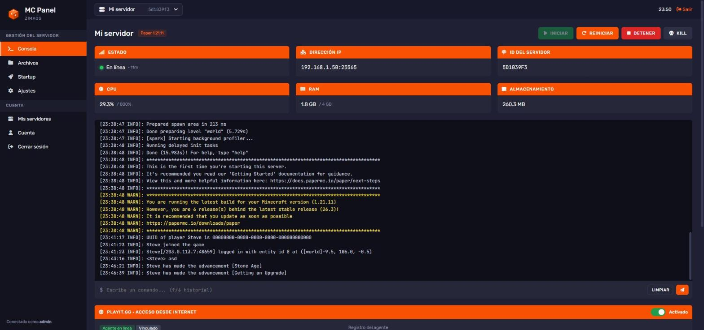
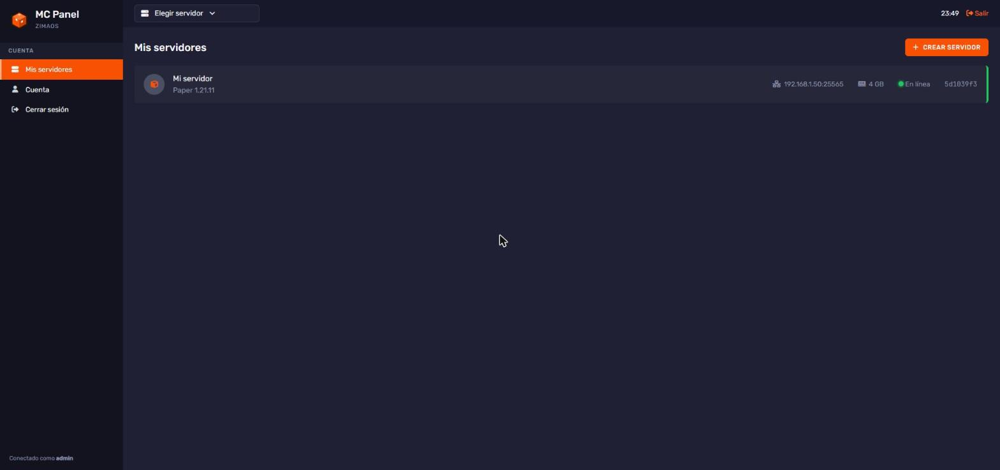
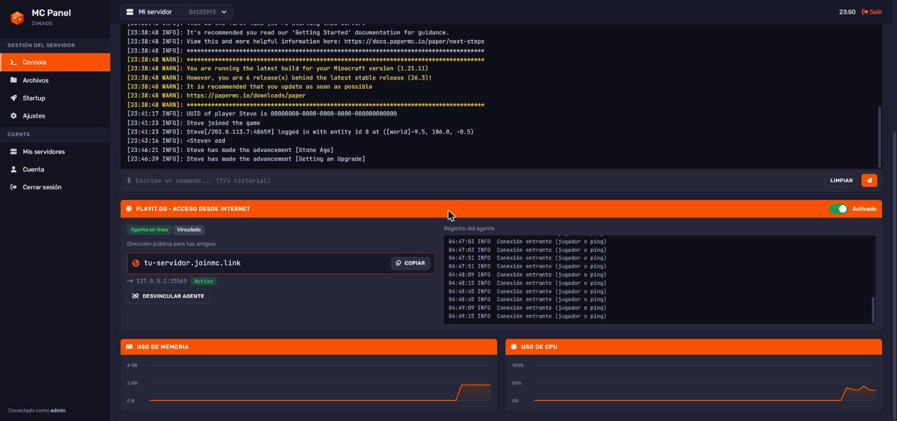
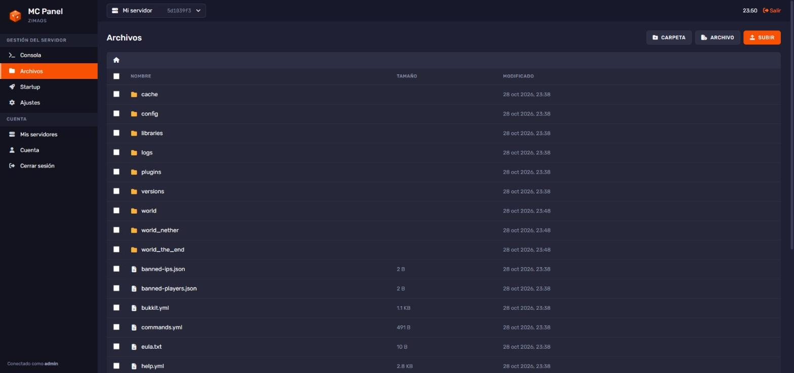
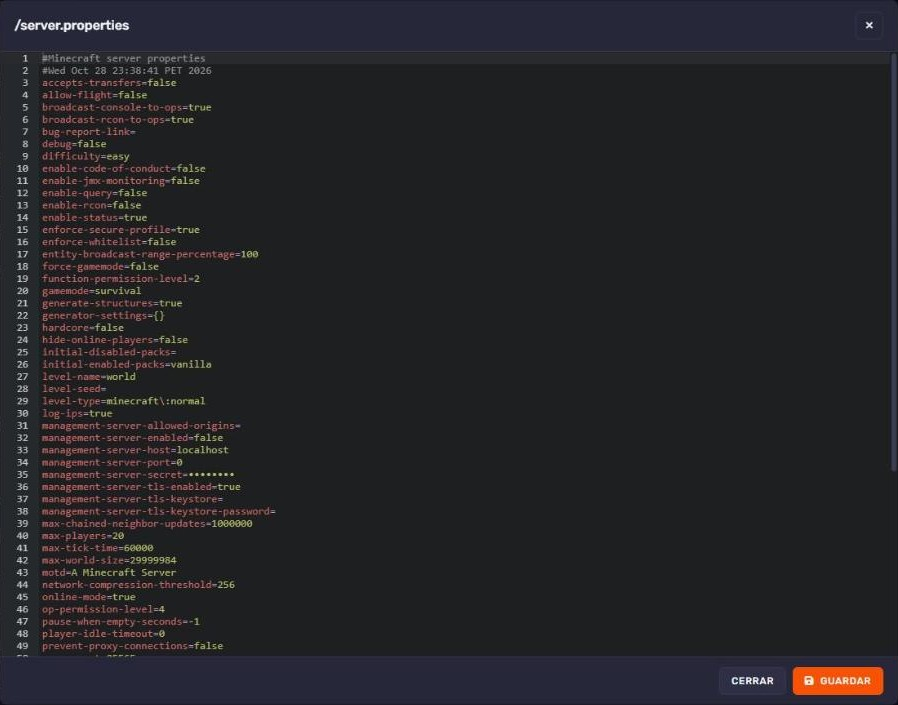
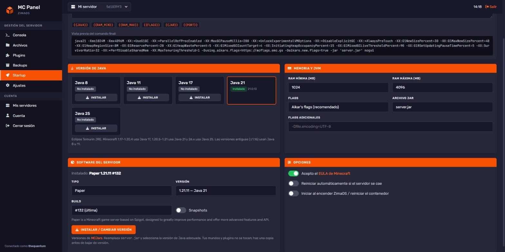

<p align="center">
  <picture>
    <source media="(prefers-color-scheme: dark)" srcset="docs/brand/mcpanel-horizontal-dark.svg">
    
  </picture>
</p>

# MC Panel para ZimaOS

Panel web en PHP para administrar servidores de Minecraft en casa. Está pensado para [ZimaOS](https://www.zimaspace.com/) y CasaOS, pero funciona en cualquier máquina con Docker. Tiene consola en vivo, gestor de archivos, editor de arranque (Startup) con varias versiones de Java, y túneles de [playit.gg](https://playit.gg) para jugar desde internet sin abrir puertos. El diseño está inspirado en el panel de Bloom.host.

No usa base de datos ni hay que compilar nada: corre sobre la imagen oficial `php:8.5-cli`, y Java, los servidores y playit se descargan desde el propio panel.

## Requisitos

- **PHP 8.3 o superior.** El panel no arranca con versiones anteriores.
- **PHP con los parches del 21 de octubre de 2026:** 8.3.36, 8.4.27, 8.5.12 o posteriores. Ojo: las distribuciones como Debian o Ubuntu a veces aplican parches sin cambiar el número de versión. En ese caso el aviso puede ser una falsa alarma; con las imágenes oficiales de Docker es exacto. Esas versiones corrigen *php2shell*, dos fallos de ejecución remota de código sin autenticación que se están explotando activamente ([CVE-2026-109618 y CVE-2026-109619](https://www.cisa.gov/news-events/alerts/2026/10/21/critical-vulnerabilities-php-require-immediate-patching)). También arreglan fallos del servidor integrado `php -S`, que es el que usa el panel. Si tu PHP es anterior, el panel muestra un aviso rojo en la parte superior.
- Linux (o WSL/Docker) con `bash`, `tar` y las extensiones `curl` y `posix`, que ya vienen en las imágenes oficiales de PHP.

La imagen recomendada es `php:8.5-cli`, la rama estable más nueva y con soporte activo; `php:8.4-cli` y `php:8.3-cli` también funcionan. Las etiquetas `8.x-cli` reciben los parches de seguridad, pero Docker solo los descarga cuando vuelves a bajar la imagen (`docker pull`, o "Actualizar" en ZimaOS).



## Funciones

| | |
| --- | --- |
| **Consola** | Log en tiempo real con colores (WARN/ERROR resaltados), envío de comandos con historial ↑/↓, botones Iniciar / Reiniciar / Detener / Kill, y tarjetas y gráficas de CPU, RAM y disco. |
| **playit.gg** | Interruptor para exponer el servidor a internet. La primera vez muestra un enlace de vinculación y detecta solo cuando lo apruebas. Luego muestra la dirección pública con botón para copiarla. |
| **Archivos** | Navegar, editar con resaltado de sintaxis (Ace, Ctrl+S guarda) y subir archivos o carpetas enteras arrastrándolos. Desde el menú ⋯ o con clic derecho: renombrar, mover y copiar (con selector de carpetas), descargar (las carpetas como `.tar.gz`), comprimir en `.zip` o `.tar.gz`, descomprimir "aquí" o "en carpeta", y borrar. También permite selección múltiple y atajos de teclado (Supr, F2, Esc). |
| **Startup** | Comando de inicio editable con variables, Java 8/11/17/21/25 (Eclipse Temurin, se instalan con un clic), RAM, flags de Aikar, archivo jar, aceptación del EULA, reinicio automático e inicio al arrancar el sistema. |
| **Software** | Instala o cambia la versión de Paper, Purpur, Vanilla o Fabric. Elige solo la versión de Java que necesita cada versión de Minecraft. |
| **Varios servidores** | Cada uno tiene su puerto, su carpeta y su propio túnel de playit. |

## Capturas

| Servidores | Acceso desde internet con playit.gg |
| --- | --- |
|  |  |
| **Gestor de archivos** | **Editor** |
|  |  |
| **Startup** | |
|  | |

## Instalación en ZimaOS / CasaOS

1. Descarga este repositorio como `.tar.gz` y renómbralo a `mcpanel.tar.gz`:
   ```bash
   git clone https://github.com/LeonardoRRC/mcpanel-zimaos.git mcpanel
   tar -czf mcpanel.tar.gz mcpanel
   ```
2. Con la app **Files** de ZimaOS, crea la carpeta `/DATA/AppData/mcpanel/` y sube ahí `mcpanel.tar.gz`.
3. Ve a **Tienda de Aplicaciones** → **Instalar aplicación personalizada** → **Importar** → **Docker Compose** y elige [`docker-compose.yml`](docker-compose.yml). Luego pulsa **Instalar**.
4. Abre `http://IP-DE-TU-ZIMAOS:8090`. La primera vez te pide crear el usuario administrador.

Al arrancar por primera vez, el contenedor descomprime el panel en `app/`.

**Para actualizar:** reemplaza `mcpanel.tar.gz`, borra la carpeta `app/` y reinicia la app. También puedes descomprimir encima con `tar -xzf mcpanel.tar.gz -C app --strip-components=1`. Tus servidores y tu configuración no se tocan.

### Con Docker en cualquier Linux

```bash
git clone https://github.com/LeonardoRRC/mcpanel-zimaos.git /opt/mcpanel/app
docker run -d --name mcpanel --network host --init --restart unless-stopped \
  -e DATA_DIR=/data -e PANEL_PORT=8090 \
  -v /opt/mcpanel/app:/app -v /opt/mcpanel/data:/data -w /app \
  php:8.5-cli bash /app/start.sh
```

### Variables de entorno

| Variable | Por defecto | Descripción |
| --- | --- | --- |
| `PANEL_PORT` | `8090` | Puerto de la interfaz web |
| `DATA_DIR` | `/data` | Dónde se guardan servidores, Java y configuración |
| `PANEL_NAME` | `MC Panel` | Nombre que se muestra en la barra lateral y el login |
| `PUBLIC_HOST` | host con el que abres el panel | Dirección que se muestra para conectarse en la red local |
| `PHP_CLI_SERVER_WORKERS` | `8` | Procesos PHP que atienden peticiones en paralelo |

## Cómo funciona

```
navegador ──HTTP──▶ php -S (router.php)
                      ├─ index.php   páginas (login, servidores, consola, archivos, startup, ajustes)
                      └─ api.php     API JSON (polling cada 1 s de consola y estadísticas)
                                   │
           ┌───────────────────────┼─────────────────────────────┐
           ▼                       ▼                             ▼
 scripts/run-server.sh      cli/job.php                  scripts/run-playit.sh
 java … < FIFO stdin        descargas en segundo plano   playitd --secret …
 > run/<id>/console.log     (Java, jars, playit)         socket IPC ◀── Playit.php (get_state)
```

- **Procesos sin `screen` ni `tmux`.** Cada servidor corre en `run-server.sh`, que conecta el stdin de Java a un FIFO (`run/<id>/stdin`). El panel envía comandos escribiendo en ese FIFO y lee la consola de `console.log`. Ese script también se encarga del reinicio automático si el servidor se cae.
- **Estadísticas:** CPU y RAM se leen de `/proc/<pid>` y el disco con `du`. Las gráficas se dibujan en un `<canvas>`, sin librerías.
- **Descargas:** Java viene de la API de Adoptium; los jars, de Mojang, PaperMC (Fill v3), Purpur y Fabric Meta. Corren como trabajos en segundo plano (`cli/job.php`) y la interfaz muestra su progreso.
- **playit.gg (agente ≥ 1.1):**
  1. `playit-cli claim generate` → `claim url`: el panel te muestra el enlace.
  2. `playit-cli claim exchange` espera a que apruebes la vinculación y devuelve la clave del agente.
  3. Se inicia `playitd --secret …`. El panel le pide los túneles por su socket IPC (JSON por líneas, `{"type":"get_state"}`) y muestra la dirección pública y el destino. Si el túnel apunta a otro puerto, te avisa.
- **Red host:** el contenedor usa la red del host, así que cualquier puerto de Minecraft queda abierto en la IP de la máquina sin mapear puertos.
- **Arranque:** al iniciar el contenedor, `cli/boot.php` vuelve a levantar los servidores marcados con "iniciar al encender" y los túneles de playit que estaban activos.

### Dónde se guardan los datos (`DATA_DIR`)

| Carpeta | Contenido |
| --- | --- |
| `servers/<id>/` | Archivos de cada servidor (mundos, plugins, configuración) |
| `java/<versión>/` | JREs de Temurin instalados |
| `bin/` | `playitd` y `playit-cli` |
| `panel/` | Usuarios (contraseñas con hash bcrypt), configuración de cada servidor y claves de playit |
| `run/<id>/` | Log de consola, PIDs, FIFO y estado del agente playit |
| `jobs/` | Estado de las descargas en curso (se limpia a las 24 h) |

### Estructura del código

```
api.php, index.php, router.php   entrada HTTP
lib/        Auth, Server (procesos y estadísticas), Files, Java, Software, Playit, Job
views/      plantillas PHP (layout, páginas)
assets/     CSS y JS sin framework (consola, archivos, startup, servidores)
cli/        job.php (descargas), boot.php (arranque)
scripts/    run-server.sh, run-playit.sh
start.sh    punto de entrada del contenedor
```

## Seguridad

- Exige PHP ≥ 8.3, avisa si a tu versión le faltan los parches de php2shell, y arranca con `session.upload_progress.enabled=0`. Esa función no la usa el panel y es la que atacan esos CVE.
- Las sesiones usan cookies `HttpOnly` y `SameSite=Lax`, todas las acciones POST llevan token CSRF, y un login fallido se ralentiza.
- El gestor de archivos no puede salir de la carpeta de cada servidor: normaliza rutas y comprueba los enlaces simbólicos con `realpath`.
- El panel está pensado para tu red local. Si lo expones a internet, ponlo detrás de un proxy con HTTPS (Nginx Proxy Manager, Cloudflare Tunnel, Tailscale…). Para que la gente juegue usa playit.gg; para administrar no hace falta exponer el panel.
- Los procesos del contenedor corren como root, igual que la mayoría de apps de ZimaOS. Instala solo plugins y mods de confianza.

## Desarrollo local

Necesitas Linux o WSL con PHP 8.3+ (con los parches de octubre de 2026) y las extensiones `curl` y `posix`:

```bash
DATA_DIR=$PWD/.data PANEL_PORT=8090 bash start.sh
```

## Logo

El logo es **Bloque consola**: un cubo con el prompt `>_` en su cara superior. En [`docs/brand/`](docs/brand/) están todas sus versiones: color, un solo color, lockups e iconos.

## Licencia

[MIT](LICENSE) © 2026 Leonardo Reynoso. Puedes usarlo, modificarlo y redistribuirlo, siempre que conserves el aviso de copyright.

---

Hecho para un homelab con ZimaOS. Minecraft es una marca de Mojang/Microsoft; este proyecto no está afiliado a ellos ni a Bloom.host o playit.gg.
